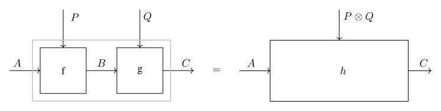
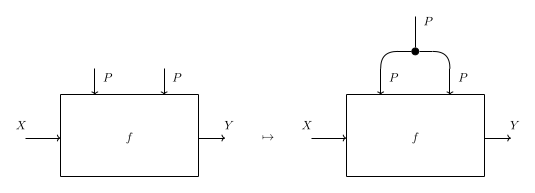
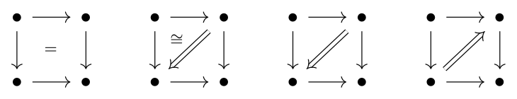
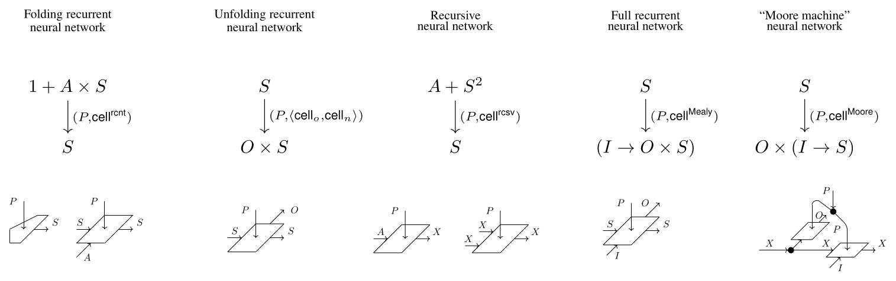
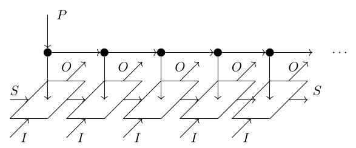
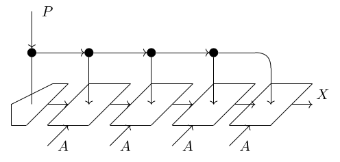

## Dos maneras de describir una red

Hay, en la práctica, dos maneras de especificar una arquitectura de red neuronal. La primera va *de arriba abajo*: se fijan las **restricciones** que el modelo debe cumplir (por ejemplo, respetar la estructura de los datos que procesa) y de ellas se deduce la forma de las capas. La segunda va *de abajo arriba*: se describe la **implementación**, la secuencia de operaciones con tensores que realiza el paso hacia delante y hacia atrás.

El ejemplo más logrado del primer enfoque es el aprendizaje profundo geométrico (*geometric deep learning*, GDL), que usa teoría de grupos y de representaciones para describir las capas mediante restricciones de simetría. Las capas concretas se obtienen resolviendo *restricciones de equivarianza*: la convolución aparece como solución exacta a la equivarianza lineal bajo traslaciones en una rejilla; el paso de mensajes y la autoatención, como casos de equivarianza bajo permutaciones en grafos. El segundo enfoque está encarnado en las bibliotecas de diferenciación automática (TensorFlow, PyTorch, JAX), que tratan las redes como «funciones puras» y permiten inferir formas de tensores y automatizar la retropropagación.

El artículo de Gavranović, Lessard, Dudzik, von Glehn, Araújo y Veličković[^arxiv] parte de que cada enfoque, por separado, se queda corto. El GDL está atado a los grupos: solo puede expresar equivarianza respecto de simetrías, es decir, de operaciones invertibles, y muchas operaciones que interesan en informática no lo son (un algoritmo de caminos mínimos, por ejemplo, transforma los datos de manera irreversible). Las bibliotecas de diferenciación automática, por su parte, describen la sintaxis de un programa, pero inferir sus propiedades generales a partir de esa sintaxis es difícil salvo en los casos más simples.

> «If we want a *general* guiding framework for *all* of deep learning, this needs to change.» (Gavranović et al., p. 1)

## La propuesta

La tesis del artículo es que un marco general para el aprendizaje profundo tiene que tender un puente entre restricciones e implementaciones, que ese puente debe venir de la informática y que debe generalizar a la vez la teoría de grupos (de donde viene el GDL) y la programación funcional (de donde vienen las bibliotecas de diferenciación). El candidato natural, según los autores, es la teoría de categorías; en concreto, el álgebra universal de mónadas valorada en una 2-categoría de funciones paramétricas.

El título tiene una lectura precisa, que una nota a pie de la primera página aclara: debe entenderse como «Categorical Deep Learning is an Algebraic {Theory of All Architectures}» y no como «… is an {Algebraic Theory} of All Architectures». Es decir, se propone una teoría de todas las arquitecturas que es algebraica, no una «teoría algebraica» en el sentido técnico de Lawvere (aunque esas teorías aparecen en un apéndice).

La teoría de categorías se presenta aquí con un argumento pragmático:

> «Minimally, it may be conceived of as a battle-tested system of *interfaces* that are learned once, and then reliably applied across scientific fields.» (Gavranović et al., p. 2)

Los autores señalan su uso ya extendido en teoría de sistemas, aprendizaje bayesiano, teoría de la información, diferenciación automática, procesamiento de lenguaje natural e inferencia causal, y la existencia de una descripción categórica completa del aprendizaje basado en gradientes (Cruttwell et al., 2022), en la que se apoya buena parte del trabajo.

## Categorías, funtores y transformaciones naturales

El artículo recuerda tres nociones básicas. Una **categoría** consta de objetos y morfismos entre ellos, con un morfismo identidad para cada objeto y una composición asociativa. El ejemplo de referencia es $\mathsf{Set}$, cuyos objetos son conjuntos y cuyos morfismos son funciones. Otro ejemplo, importante para el GDL, es que un grupo $G$ puede verse como una categoría $\mathcal{B}G$ con un solo objeto, cuyos morfismos son los elementos de $G$; si los morfismos no son necesariamente invertibles, se obtiene un monoide.

Un **funtor** $F : \mathcal{C} \to \mathcal{D}$ lleva objetos y morfismos de una categoría a otra respetando identidades y composición; si $\mathcal{C} = \mathcal{D}$, se llama *endofuntor*. Una **transformación natural** $\alpha : F \Rightarrow G$ entre dos funtores elige, para cada objeto $X$, un morfismo $\alpha_X : F(X) \to G(X)$ de manera que, para todo $f : X \to Y$,

$$\alpha_Y \circ F(f) = G(f) \circ \alpha_X .$$

Con estas tres piezas se construye el resto.

## Mónadas y sus álgebras

Una **mónada** sobre una categoría $\mathcal{C}$ es una terna $(M, \eta, \mu)$: un endofuntor $M$ y dos transformaciones naturales, la unidad $\eta : \mathrm{id} \Rightarrow M$ y la multiplicación $\mu : M \circ M \Rightarrow M$, que cumplen ciertas leyes de coherencia. El ejemplo central es la *mónada de acción de grupo*: dado un grupo $G$, el endofuntor $G \times - : \mathsf{Set} \to \mathsf{Set}$ lleva cada conjunto $X$ a $G \times X$; la unidad envía $x$ a $(e, x)$ y la multiplicación envía $(g, h, x)$ a $(gh, x)$.

Esta mónada es una teoría formal de las acciones de un grupo, pero no las ejecuta sobre ningún dato:

> «Group action monads are formal theories of group actions, but they do not allow us to actually *execute* them on data. This is what *algebras* do.» (Gavranović et al., p. 4)

Un **álgebra** para la mónada es un par $(A, a)$: un objeto portador $A$ y un morfismo $a : M(A) \to A$ compatible con la unidad y la multiplicación. Para la mónada $G \times -$, un álgebra es exactamente una acción de $G$ sobre $A$. Si el portador es $\mathbb{R}^{\mathbb{Z}_w \times \mathbb{Z}_h}$, datos sobre una rejilla de $w \times h$, las acciones habituales son traslaciones, rotaciones, permutaciones, escalados o reflexiones. La traslación, por ejemplo, se escribe $((i', j') \blacktriangleright x)(i, j) = x(i - i', j - j')$.

Un álgebra describe un dato de entrada o de salida de la red. Para describir la red misma hace falta un **homomorfismo de álgebras**: un morfismo $f : A \to B$ que hace conmutar el cuadrado

$$
\begin{CD}
M(A) @>{M(f)}>> M(B) \\
@V{a}VV @VV{b}V \\
A @>>{f}> B
\end{CD}
$$

Para la mónada de acción de grupo, ese cuadrado se reduce, elemento a elemento, a la ecuación de equivarianza

$$f(g \blacktriangleright x) = g \blacktriangleright f(x).$$

Con la traslación se recupera la restricción habitual de las convoluciones: $f(x(i - i', j - j')) = f(x)(i - i', j - j')$. Es el resultado central de la primera parte: el objetivo del GDL, encontrar capas equivariantes, consiste en encontrar homomorfismos de álgebras para mónadas asociadas a acciones de grupo. Si el codominio lleva la acción trivial (la proyección que olvida $g$), la ecuación se convierte en la de invarianza, $f(g \blacktriangleright x) = f(x)$. Los apéndices derivan con la misma plantilla las redes neuronales de grafos (grupo de permutaciones $\Sigma_n$), las CNN esféricas (grupo $\mathrm{SO}(3)$) y las G-CNN.

<!-- FIGURA: Gavranović et al., ejemplo 2.6 (p. 4), diagrama conmutativo de G × R^{Z_w×Z_h}. Opcional: el cuadrado CD de arriba ya lo reproduce. Recortar y guardar como img/posts/aprendizaje-profundo-categorico/equivarianza.png si se prefiere la versión del PDF. -->

## Del grupo al reparto de pesos

Para pasar de las restricciones a las capas concretas hay que fijar la categoría en que viven los morfismos. La elección habitual es $\mathsf{Vect}$: espacios vectoriales de dimensión finita y aplicaciones lineales. Ahí los morfismos son matrices, y la condición de equivarianza restringe sus entradas. El resultado es lo que en la práctica se llama *reparto* o *atadura de pesos* (*weight sharing*, *weight tying*).

El apéndice H lo calcula con el caso mínimo: dos píxeles. Sea $f_{\mathbf{W}} : \mathbb{R}^{\mathbb{Z}_2} \to \mathbb{R}^{\mathbb{Z}_2}$ la aplicación lineal dada por

$$\mathbf{W} = \begin{bmatrix} w_1 & w_3 \\ w_2 & w_4 \end{bmatrix},$$

y sea la acción del grupo de traslaciones $(\mathbb{Z}_2, +, 0)$, que en este caso consiste en intercambiar los dos píxeles. Exigir que $f_{\mathbf{W}}$ sea equivariante obliga a $w_3 = w_2$ y $w_4 = w_1$:

$$\mathbf{W} = \begin{bmatrix} w_1 & w_2 \\ w_2 & w_1 \end{bmatrix}.$$

De cuatro parámetros libres quedan dos, y la matriz resulta simétrica. En dominios mayores, la misma restricción obliga a que $\mathbf{W}$ sea *circulante*, y las matrices circulantes son lo que en redes neuronales se llama capas convolucionales. Si en lugar de equivarianza se pide invarianza, las filas de la matriz quedan iguales,

$$\mathbf{W} = \begin{bmatrix} w_1 & w_3 \\ w_1 & w_3 \end{bmatrix},$$

y los dos píxeles de salida toman el mismo valor: la capa equivale a un producto escalar con $[\,w_1 \;\; w_3\,]$, que elimina la estructura de rejilla.

## Más allá de los grupos: álgebras de endofuntores

Las mónadas de acción de grupo son elegantes, pero heredan las limitaciones de la teoría de grupos. El paso siguiente del artículo es quitar estructura: en lugar de una mónada, basta un **endofuntor** $F$, y un álgebra para $F$ es simplemente un par $(A, a)$ con $a : F(A) \to A$, sin ecuaciones adicionales. Con esta noción más débil reaparecen construcciones conocidas de la informática.

Las **listas** de elementos de $A$ forman un álgebra del endofuntor $1 + A \times -$, con la aplicación $[\mathsf{Nil}, \mathsf{Cons}]$; es la definición inductiva habitual:

```haskell
data List a = Nil
            | Cons a (List a)
```

Los **árboles binarios** con hojas etiquetadas en $A$ forman un álgebra de $A + (-)^2$, con $[\mathsf{Leaf}, \mathsf{Node}]$.

Un homomorfismo de álgebras desde las listas a cualquier otra $(1 + A \times -)$-álgebra $(X, [r_0, r_1])$ es necesariamente un *fold*, el pliegue de la programación funcional:

```haskell
f_r :: List a -> x
f_r Nil         = r_0 ()
f_r (Cons h t)  = r_1 h (f_r t)
```

Desplegar la conmutatividad del cuadrado da dos ecuaciones:

$$f_r(\mathsf{Nil}) = r_0(\bullet), \qquad f_r(\mathsf{Cons}(h, t)) = r_1(h, f_r(t)).$$

Los autores subrayan que estas ecuaciones *generalizan* las restricciones de equivarianza: como en el caso de los grupos, especifican una función que se comporta de manera predecible frente a ciertas operaciones, solo que ahora la operación (añadir un elemento delante de una lista) no es invertible y no es una acción de grupo. Además, el homomorfismo desde las listas es único, porque las listas son el objeto inicial en la categoría de $(1 + A \times -)$-álgebras. Para los árboles ocurre lo mismo: el homomorfismo es un pliegue sobre el árbol, implementado por recursión estructural.

## Coálgebras y autómatas

Invirtiendo la flecha se obtienen las **coálgebras**: pares $(A, a)$ con $a : A \to F(A)$. Si las álgebras sirven para modelar cómputos que terminan, las coálgebras modelan cómputos potencialmente infinitos, cuya garantía no es la terminación sino la *productividad*: servidores, sistemas operativos, autómatas.

El ejemplo principal es la **máquina de Mealy**: dados conjuntos de entradas $I$ y salidas $O$, las máquinas de Mealy forman una coálgebra del endofuntor $I \to O \times -$. La definición es coinductiva: una máquina que, dada una entrada, produce una salida y otra máquina.

```haskell
data Mealy o i = MkMealy {
  next :: i -> (o, Mealy o i)
}
```

Los homomorfismos de coálgebras hacia las máquinas de Mealy son *unfolds*, despliegues: funciones que generan una estructura potencialmente infinita a partir de un solo valor, implementadas por corecursión. También satisfacen ecuaciones de «equivarianza generalizada», ahora para un autómata interactivo que no es invertible y cuya salida depende de su estado y de entradas desconocidas de antemano. Los apéndices tratan del mismo modo los *streams* (coálgebras de $O \times -$) y las máquinas de Moore (coálgebras de $O \times (I \to -)$).

El caso de los streams da un ejemplo claro de reparto de pesos. Si se trabaja en $\mathsf{Vect}$ con una coálgebra sobre $\mathbb{R}$ dada por dos escalares $w_o$ (salida) y $w_n$ (estado siguiente), el homomorfismo universal hacia los streams es una matriz infinita que queda completamente determinada por esos dos números:

$$\begin{bmatrix} w_o & w_n w_o & w_n^2 w_o & w_n^3 w_o & \cdots \end{bmatrix}$$

Es, en miniatura, lo que hace una red recurrente desenrollada en el tiempo: repetir los mismos pesos en cada paso.

| Endofuntor | Estructura | Tipo | Morfismo universal | Red neuronal |
|---|---|---|---|---|
| $G \times -$ (mónada) | acción de grupo | álgebra | aplicación equivariante | capa del GDL (CNN, GNN) |
| $1 + A \times -$ | listas | álgebra | *fold* | RNN que pliega |
| $A + (-)^2$ | árboles binarios | álgebra | *fold* sobre árboles | red recursiva |
| $O \times -$ | *streams* | coálgebra | *unfold* | RNN que despliega |
| $I \to O \times -$ | máquinas de Mealy | coálgebra | *unfold* | RNN completa |
| $O \times (I \to -)$ | máquinas de Moore | coálgebra | *unfold* | celda tipo Moore |

## Parámetros: la 2-categoría Para

Hasta aquí, todo el análisis del reparto de pesos supone que los homomorfismos son lineales, porque se los coloca en $\mathsf{Vect}$. Eso limita el estudio a capas sueltas. Una celda de red recurrente, en cambio, es una composición de aplicaciones lineales y no lineales:

> «In the standard example of recurrent neural networks, an RNN cell is an *arbitrary* differentiable function, usually composed out of a sequence of linear and non-linear maps.» (Gavranović et al., p. 7)

Además, en la práctica las redes son funciones *paramétricas*, y en bibliotecas como JAX los parámetros se pasan explícitamente en cada llamada. Para tratar ambas cosas sin abandonar el marco, el artículo sube un nivel: de las categorías a las **2-categorías**, que además de objetos y morfismos tienen morfismos entre morfismos (2-morfismos). El ejemplo canónico es $\mathsf{Cat}$, cuyos objetos son categorías, cuyos morfismos son funtores y cuyos 2-morfismos son transformaciones naturales.

La 2-categoría que interesa es $\mathsf{Para}$ (Cruttwell et al., 2022; Capucci et al., 2022). Sus objetos son los de $\mathsf{Set}$, pero un morfismo $A \to B$ no es una función, sino un par $(P, f)$ con $f : P \times A \to B$: una función que depende de un espacio de parámetros $P$. En los diagramas de cuerdas, el parámetro se dibuja en vertical, para indicar que forma parte del morfismo y no de los objetos. Al componer dos morfismos paramétricos, los espacios de parámetros se componen en paralelo: $(P, f)$ seguido de $(Q, g)$ da un morfismo con parámetros $Q \times P$.

<!-- FIGURA: Gavranović et al., fig. 4 (p. 22). Recortar del PDF y guardar como img/posts/aprendizaje-profundo-categorico/fig4-composicion-para.png -->


Los 2-morfismos de $\mathsf{Para}$ son *reparametrizaciones*: aplicaciones $r : P' \to P$ entre espacios de parámetros que convierten un morfismo paramétrico en otro. Y aquí aparece el tratamiento explícito del reparto de pesos: un morfismo $(P \times P, f)$, que usa dos copias de los parámetros, se convierte en uno con los pesos atados precomponiéndolo con la aplicación de copia

$$\Delta_P : P \to P \times P, \qquad p \mapsto (p, p).$$

<!-- FIGURA: Gavranović et al., p. 8 (diagrama sin número). Guardar como img/posts/aprendizaje-profundo-categorico/atadura-de-pesos.png -->


Atar pesos es, literalmente, reparametrizar a través de una copia. Los autores formulan su tesis en estos términos:

> «It is our position that the 2-category Para and 2-categorical algebra valued in it provide a *formal theory of neural network architectures*, establish **formal criteria** for weight tying correctness and **inform design** of new architectures.» (Gavranović et al., p. 8)

## Redes recurrentes como álgebras laxas

En una 2-categoría, un cuadrado no tiene por qué limitarse a conmutar o no conmutar: puede conmutar estrictamente, conmutar salvo isomorfismo (*pseudo*), o tener un 2-morfismo que va de un camino al otro en una dirección (*lax*) o en la contraria (*oplax*).

<!-- FIGURA: Gavranović et al., p. 8 (diagrama sin número). Guardar como img/posts/aprendizaje-profundo-categorico/cuadrados-2-celdas.png -->


De estas variantes, el artículo se ocupa de las **álgebras laxas**, que bastan para derivar redes recursivas y recurrentes desde primeros principios.

La construcción es la misma de antes, trasladada a $\mathsf{Para}$. Gracias a una propiedad técnica (la *fuerza* actegórica del endofuntor), cada endofuntor de la sección anterior se eleva a un 2-endofuntor sobre $\mathsf{Para}(\mathsf{Set})$, y sus álgebras son ahora celdas paramétricas:

- un álgebra de $\mathsf{Para}(1 + A \times -)$ consiste en un estado oculto $S$, una elección de estado inicial y una celda $P \times A \times S \to S$: una **red recurrente que pliega** una secuencia de entradas;
- un álgebra de $\mathsf{Para}(A + (-)^2)$ es una **celda de red recursiva** sobre árboles;
- una coálgebra de $\mathsf{Para}(O \times -)$ es una **red recurrente que despliega** un stream de salidas a partir de un estado;
- una coálgebra de $\mathsf{Para}(I \to O \times -)$ es una celda que consume estado y entrada y produce salida y nuevo estado: una **red recurrente completa**.

<!-- FIGURA: Gavranović et al., fig. 1 (p. 8). Recortar del PDF y guardar como img/posts/aprendizaje-profundo-categorico/fig1-coalgebras-parametricas.png -->


El último caso lleva a una observación que los autores destacan:

> «This suggests that recurrent neural networks can be thought of as learnable Mealy machines, a perspective seldom advocated for in the literature.» (Gavranović et al., p. 29)

<!-- FIGURA: Gavranović et al., fig. 13 (p. 31). Guardar como img/posts/aprendizaje-profundo-categorico/fig13-mealy.png -->


Lo que conecta una celda con la red completa es el *desenrollado*. El apéndice J lo construye como un homomorfismo laxo de álgebras: para la red que pliega listas, el homomorfismo es el análogo paramétrico de un *fold*,

```haskell
f_rcnt :: (p, List a) -> x
f_rcnt p Nil          = cell_rcnt p (inl ())
f_rcnt p (Cons a as)  = cell_rcnt p (inr a (f_rcnt p as))
```

donde la llamada recursiva usa el mismo parámetro `p`. El 2-morfismo que hace funcionar el cuadrado laxo es precisamente la copia $\Delta_P$: ata el parámetro de la celda en cada paso al de la llamada recursiva.

<!-- FIGURA: Gavranović et al., fig. 10 (p. 30). Recortar del PDF y guardar como img/posts/aprendizaje-profundo-categorico/fig10-rnn-desenrollada.png -->


El resultado general que justifica todo esto es el teorema G.10: las celdas laxas de un álgebra para $\mathsf{Para}(T)$, con $T$ una mónada fuerte, son exactamente un *comonoide* sobre el espacio de parámetros, es decir, un par de aplicaciones $!_P : P \to 1$ (borrar) y $\Delta_P : P \to P \times P$ (copiar) que cumplen las leyes de comonoide. El reparto de pesos no se añade a mano: sale de la estructura.

> «The fact that we can duplicate or delete entries in vectors—the essence of tying weights—is the informal face of this comonoid structure.» (Gavranović et al., pp. 8–9)

Queda una pieza conjetural. En el caso 1-dimensional, cada endofuntor tiene asociada una *mónada algebraicamente libre*, cuya categoría de álgebras equivale a la de álgebras del endofuntor, y que se obtiene iterando el endofuntor hasta que se estabiliza (la construcción transfinita de Kelly). Los autores conjeturan (conjetura G.12) que lo mismo vale en $\mathsf{Para}$, de modo que las redes recurrentes y recursivas serían álgebras laxas de mónadas paramétricas libres generadas por endofuntores paramétricos.

## Nuevos horizontes

La última sección del cuerpo del artículo es programática. Los autores sostienen que su marco da «la definición correcta» de muchas variantes de redes estructuradas, como contrapartes paramétricas universales de nociones conocidas de la informática:

> «Our framework gives *the correct definition* of numerous variants of structured networks as universal parametric counterparts of known notions in computer science.» (Gavranović et al., p. 9)

De ahí derivan varias líneas de trabajo:

- **Restricciones aprendibles más generales.** Como las álgebras de mónadas pueden ser paramétricas y laxas, cabría diseñar redes que no aprendan solo leyes de conservación, sino argumentos lógicos o código verificablemente correctos; por ejemplo, redes que solo aprendan funciones bien tipadas, eligiendo las álgebras adecuadas como dominio y codominio.
- **Contenedores y funtores polinómicos.** Tomarlos como endofuntores daría una manera uniforme de razonar sobre tipos de datos y funciones polimórficas, y, combinada con la diferenciación automática puramente funcional, abriría el diseño de redes *type-safe* en lenguajes funcionales.
- **No linealidades.** El GDL trata sobre todo capas lineales sueltas y no explica la elección de las no linealidades, que en la práctica importa mucho. Este marco razona sobre bloques que abarcan varias capas, como muestran los ejemplos de reparto de pesos.
- **Sesgo inductivo y verificación.** Los autores esperan que una lógica categórica aclare la relación entre arquitectura y razonamiento, y permita evaluar sesgo, equidad y corrección en sistemas desplegados a escala: una IA «no meramente explicable, sino verificable».

## Valoración

El artículo es un *position paper* presentado en ICML 2024, y conviene leerlo como tal. Su aportación principal es una reformulación unificada: muestra que la equivarianza del GDL, los pliegues y despliegues de la programación funcional y el reparto de pesos de las redes recurrentes son casos de una misma construcción, el homomorfismo de álgebras, y que la atadura de pesos tiene una forma precisa (la reparametrización por copia, la estructura de comonoide). El ejemplo de los dos píxeles y el de los streams muestran bien cómo una condición abstracta se traduce en igualdades entre entradas de una matriz.

Dos cuestiones quedan abiertas. La primera es el alcance de la afirmación «todas las arquitecturas». Las derivaciones detalladas cubren capas equivariantes y redes recurrentes y recursivas; los transformadores y la atención solo aparecen a través de su interpretación previa en el GDL. Parte del aparato 2-categórico queda en esbozo: el texto reconoce que la falta de espacio impide el detalle adecuado, una demostración se «deja al lector» y la equivalencia que llevaría de los endofuntores a las mónadas libres en $\mathsf{Para}$ es una conjetura. La segunda es el paso de recuperar a proponer. El marco reconstruye con rigor arquitecturas que ya existían, pero el artículo no incluye ninguna arquitectura nueva derivada de él ni experimentos que la evalúen. Que la teoría «informe el diseño», como promete la tesis, depende de trabajo posterior.

[^arxiv]: Bruno Gavranović, Paul Lessard, Andrew Dudzik, Tamara von Glehn, João G. M. Araújo y Petar Veličković, «Position: Categorical Deep Learning is an Algebraic Theory of All Architectures», *Proceedings of the 41st International Conference on Machine Learning* (Viena), PMLR 235, 2024; versión 2 (6 de junio de 2024), [arXiv:2402.15332](https://arxiv.org/abs/2402.15332). Las citas literales están en inglés, con el número de página del preprint.
